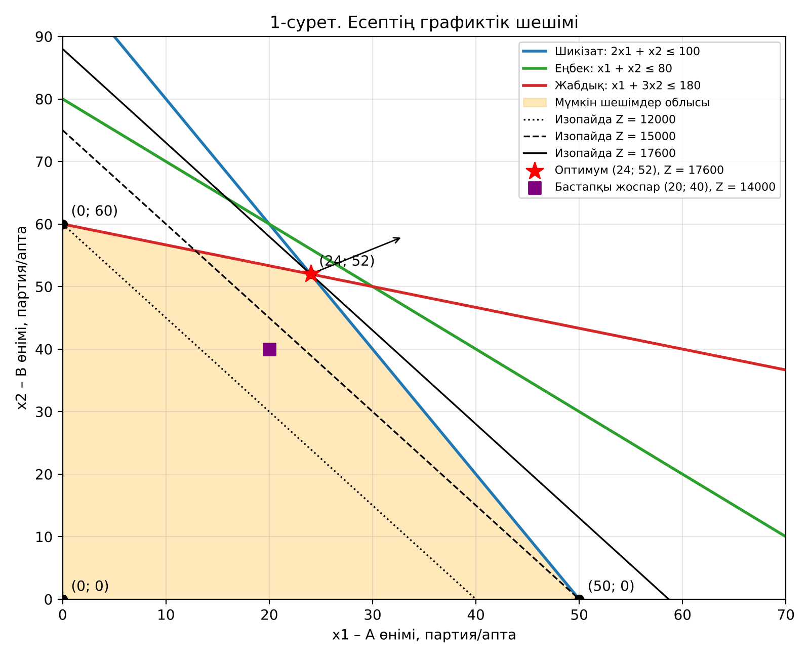
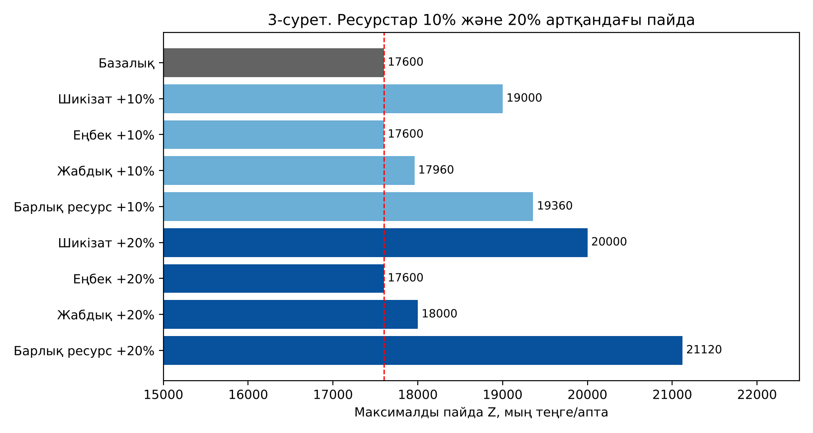

::: {custom-style="Title"}
СРО
:::

::: {custom-style="Subtitle"}
Пән: Математикалық және компьютерлік модельдеу
:::

::: {custom-style="Subtitle"}
Тақырыбы: «Кәсіпорынның өндірістік ресурстарын оңтайландыру арқылы пайданы максимизациялаудың математикалық және компьютерлік моделі»
:::

::: {custom-style="Subtitle"}
Орындаған: ______________________, 4-курс студенті, тобы ________
:::

::: {custom-style="Subtitle"}
Тексерген: ______________________
:::

::: {custom-style="Subtitle"}
20__ ж.
:::

```{=openxml}
<w:p><w:r><w:br w:type="page"/></w:r></w:p>
```

# КІРІСПЕ

**Өзектілігі.** Кәсіпорынның шикізаты, еңбек уақыты және жабдық қуаты шектеулі. Сондықтан пайданы арттырудың негізгі жолы — бар ресурстарды өнім түрлері арасында тиімді бөлу. Бұл міндетті интуицияға сүйеніп шешу пайданың бір бөлігін жоғалтуға әкеледі. Ал сызықтық бағдарламалау әдісі (Л. В. Канторович, 1939; Дж. Данциг, 1947) оңтайлы жоспарды дәл есептеуге мүмкіндік береді [1; 5].

**Мақсаты** — екі өнім шығаратын кәсіпорынның шектеулі ресурстарын бөлудің пайданы максимизациялайтын математикалық моделін құру, оны симплекс әдісімен шешу және Python тілінде компьютерлік модельдеу арқылы тексеру.

**Міндеттері:**

1. бастапқы деректерді жүйелеу;
2. математикалық модель құру;
3. есепті графиктік және симплекс әдістерімен шешу;
4. Python-да компьютерлік модель жасау;
5. нәтижелерді салыстыру;
6. ресурстар 10% және 20% артқанда сезімталдықты талдау.

**Объектісі** — екі өнім (А және В) шығаратын шартты өндірістік кәсіпорын.

**Пәні** — ресурстарды бөлудің сызықтық оңтайландыру моделі.

**Әдістері:**

- сызықтық бағдарламалау (графиктік және симплекс әдістері);
- қосарлану теориясы;
- бүтінсанды бағдарламалау (тармақтар мен шекаралар әдісі);
- Python (NumPy, SciPy, Matplotlib) көмегімен компьютерлік модельдеу.

# 1. ТЕОРИЯЛЫҚ НЕГІЗДЕР

**Экономикалық-математикалық модель** — экономикалық объектінің мәнді байланыстарын теңдеулер мен теңсіздіктер арқылы сипаттау. **Компьютерлік модель** — осы модельдің алгоритм және бағдарлама түрінде іске асырылуы. Ол есептеу эксперименттерін жүргізуге мүмкіндік береді [6].

**Сызықтық бағдарламалау есебінің жалпы түрі:**

$$Z=\sum_{j=1}^{n}c_jx_j\to\max,\qquad \sum_{j=1}^{n}a_{ij}x_j\le b_i\ (i=\overline{1,m}),\qquad x_j\ge0.$$

Белгілеулер:

- $Z$ — **мақсаттық функция** (пайда);
- $a_{ij}x_j\le b_i$ — **шектеулер жүйесі** (ресурс шығыны қордан аспайды);
- $x_j\ge0$ — теріс емес болу шарты.

Барлық шектеуді қанағаттандыратын нүктелер жиыны — **мүмкін шешімдер облысы**, ол дөңес көпбұрыш. Мақсаттық функцияға ең үлкен мән беретін мүмкін жоспар **оптималды шешім** деп аталады. СБ-ның негізгі теоремасы бойынша оптимум облыстың төбесінде жатады [2; 4].

**Симплекс әдісі** төбеден көрші төбеге өту арқылы $Z$-ті кезең-кезеңімен арттырады [1; 2]. Әдістің ережелері:

- **енгізілетін айнымалы:** Z-жолындағы ең теріс баға $\Delta_j$;
- **шығарылатын айнымалы:** ең кіші қатынас $\theta=\min\limits_{a_{ik}>0} b_i/a_{ik}$;
- **кестені түрлендіру:** тірек элементі $a_{rk}$ арқылы Жордан–Гаусс ережесі, $a'_{ij}=a_{ij}-a_{ik}a_{rj}/a_{rk}$;
- **оптималдық шарты:** барлық $\Delta_j\ge0$.

Соңғы кестедегі қосымша айнымалылардың бағалары — ресурстардың **көлеңкелі бағалары** $y_i$, яғни $b_i$ бір бірлікке артқанда пайданың өсімі.

# 2. БАСТАПҚЫ МӘЛІМЕТТЕР

Жұмыста **шартты (оқу мақсатындағы) деректер** қолданылды. Жоспарлау кезеңі — 1 апта, өлшем бірлігі — партия (1 партия = 100 дана).

**1-кесте. Ресурс шығыны нормалары, қорлар және пайда**

| Ресурс | А өнімі | В өнімі | Апталық қор |
|:---|:---:|:---:|:---:|
| Шикізат, т | 2 | 1 | 100 |
| Еңбек уақыты, жүз адам-сағ | 1 | 1 | 80 |
| Жабдық, станок-сағ | 1 | 3 | 180 |
| Бірлік пайда, мың тг/партия | 300 | 200 | — |

Кәсіпорынның қазіргі жоспары: А — 20 партия, В — 40 партия. Бұл жоспар бойынша пайда $300\cdot20+200\cdot40=14\,000$ мың тг/апта.

# 3. МАТЕМАТИКАЛЫҚ МОДЕЛЬ

Белгісіздер: $x_1$, $x_2$ — А және В өнімдерінің апталық көлемі (партия). Пайда әр өнімнің көлеміне пропорционал, ал жалпы пайда өнімдер бойынша қосылады. Әр ресурс бойынша жалпы шығын оның қорынан аспауы тиіс. Осыдан модель шығады:

$$
\begin{aligned}
&Z=300x_1+200x_2\to\max,\\
&2x_1+x_2\le100\quad\text{(шикізат)},\\
&x_1+x_2\le80\quad\text{(еңбек)},\\
&x_1+3x_2\le180\quad\text{(жабдық)},\\
&x_1\ge0,\ x_2\ge0.
\end{aligned}
$$

**Коэффициенттердің мағынасы:**

- $c_j$ — 1 партияның пайдасы;
- $a_{ij}$ — 1 партияға кететін $i$-ресурс шығыны;
- $b_i$ — $i$-ресурстың апталық қоры.

# 4. МАТЕМАТИКАЛЫҚ ШЕШУ

## 4.1. Графиктік әдіс

Шекаралық түзулерді салу арқылы мүмкін шешімдер облысының төбелері табылды. Шикізат пен жабдық түзулерінің қиылысуы былай есептеледі: $x_2=100-2x_1$ өрнегін жабдық теңдеуіне қойсақ, $x_1+3(100-2x_1)=180$, бұдан $x_1=24$, $x_2=52$.

**2-кесте. Төбелердегі пайда**

| Төбе | (0; 0) | (50; 0) | **(24; 52)** | (0; 60) |
|:---|:---:|:---:|:---:|:---:|
| $Z$, мың тг | 0 | 15 000 | **17 600** | 12 000 |

{width=14cm}

## 4.2. Симплекс әдісі

Есепті канондық түрге келтірдік. Ол үшін қосымша айнымалылар енгіздік: $s_1, s_2, s_3\ge0$ (ресурс қалдықтары). Канондық түрі:

- $2x_1+x_2+s_1=100$;
- $x_1+x_2+s_2=80$;
- $x_1+3x_2+s_3=180$;
- $Z-300x_1-200x_2=0$.

**3-кесте. Бастапқы кесте** (тірек элементі **2**: $x_1$ енеді, $s_1$ шығады, $\theta=\min\{50;80;180\}=50$)

| Базис | $x_1$ | $x_2$ | $s_1$ | $s_2$ | $s_3$ | $b$ | $\theta$ |
|:---:|:---:|:---:|:---:|:---:|:---:|:---:|:---:|
| $s_1$ | **[2]** | 1 | 1 | 0 | 0 | 100 | 50 |
| $s_2$ | 1 | 1 | 0 | 1 | 0 | 80 | 80 |
| $s_3$ | 1 | 3 | 0 | 0 | 1 | 180 | 180 |
| $Z$ | −300 | −200 | 0 | 0 | 0 | 0 | |

**4-кесте. 1-итерация** (тірек элементі **5/2**: $x_2$ енеді, $s_3$ шығады, $\theta=\min\{100;60;52\}=52$)

| Базис | $x_1$ | $x_2$ | $s_1$ | $s_2$ | $s_3$ | $b$ | $\theta$ |
|:---:|:---:|:---:|:---:|:---:|:---:|:---:|:---:|
| $x_1$ | 1 | 1/2 | 1/2 | 0 | 0 | 50 | 100 |
| $s_2$ | 0 | 1/2 | −1/2 | 1 | 0 | 30 | 60 |
| $s_3$ | 0 | **[5/2]** | −1/2 | 0 | 1 | 130 | 52 |
| $Z$ | 0 | −50 | 150 | 0 | 0 | 15 000 | |

**5-кесте. 2-итерация (оптималды кесте)**

| Базис | $x_1$ | $x_2$ | $s_1$ | $s_2$ | $s_3$ | $b$ |
|:---:|:---:|:---:|:---:|:---:|:---:|:---:|
| $x_1$ | 1 | 0 | 3/5 | 0 | −1/5 | **24** |
| $s_2$ | 0 | 0 | −2/5 | 1 | −1/5 | **4** |
| $x_2$ | 0 | 1 | −1/5 | 0 | 2/5 | **52** |
| $Z$ | 0 | 0 | 140 | 0 | 20 | **17 600** |

Z-жолындағы барлық баға теріс емес, демек шешім оптималды. Мақсаттық функция $0\to15\,000\to17\,600$ болып өсті.

Оптималды шешім:

- $x_1^*=24$, $x_2^*=52$;
- ресурс қалдықтары: $s_1=0$, $s_2=4$, $s_3=0$;
- **$Z^*=17\,600$ мың тг/апта**;
- көлеңкелі бағалар: $y_1=140$, $y_2=0$, $y_3=20$.

## 4.3. Тексеру

**Шектеулерге қою:** $2\cdot24+52=100$; $24+52=76\le80$; $24+3\cdot52=180$. Барлық шектеу орындалады.

**Қосарланған есеп арқылы:** $W=100\cdot140+80\cdot0+180\cdot20=17\,600=Z^*$, сондықтан шешім оптималды.

## 4.4. Бүтінсанды модель

Партия бөлінбейтін бірлік, сондықтан шартты түрде $x_j\in\mathbb{Z}$ қажет. Базалық шешім өзі бүтін сан. Ал ресурстар 10% артқан жағдайда ($\mathbf{b}=(110;88;198)$) үздіксіз шешім $(26{,}4;\ 57{,}2)$, $Z=19\,360$ болады.

Тармақтар мен шекаралар әдісі:

- $x_1\le26$ тармағында $Z=19\,266{,}7$;
- $x_1\ge27$ тармағында бүтін шешім $(27;56)$, $Z=19\,300$ шығады, демек бүтінсанды оптимум осы.

Жай дөңгелектеу $(26;57)$ тек $Z=19\,200$ береді. Демек бүтінсанды модель қажет.

# 5. PYTHON АРҚЫЛЫ КОМПЬЮТЕРЛІК МОДЕЛЬДЕУ

Компьютерлік модель Python 3 тілінде жасалды. Бағдарлама мәтіні жеке файлда берілген: `optimization_model.py`.

**Қолданылған кітапханалар:**

- **NumPy** — деректерді вектор мен матрица түрінде беру;
- **SciPy** — `linprog` (HiGHS әдісі) арқылы СБ есебін, `milp` арқылы бүтінсанды есепті шешу [7; 9];
- **Matplotlib** — графиктер [8].

**Бағдарламаның жұмыс кезеңдері:**

1. бастапқы деректерді енгізу ($\mathbf{c}$, $A$, $\mathbf{b}$);
2. мақсаттық функция мен шектеулерді беру ($\max Z$ есебі $\min(-Z)$ түрінде беріледі);
3. оптимизация алгоритмін іске қосу;
4. оңтайлы шешімді, максималды пайданы, ресурстардың пайдаланылуын және көлеңкелі бағаларды шығару;
5. симплекс кестелерін дәл бөлшектермен қайталап тексеру;
6. сезімталдық сценарийлерін есептеу және графиктер салу.

**6-кесте. Қолмен және компьютерлік шешімді салыстыру**

| Көрсеткіш | Симплекс әдісі (қолмен) | Python (SciPy) |
|:---|:---:|:---:|
| $x_1^*;\ x_2^*$ | 24; 52 | 24,00; 52,00 |
| $Z^*$, мың тг | 17 600 | 17 600,00 |
| Қалдықтар $s_1;s_2;s_3$ | 0; 4; 0 | 0; 4; 0 |
| Көлеңкелі бағалар $y_1;y_2;y_3$ | 140; 0; 20 | 140; 0; 20 |

Нәтижелер толық сәйкес келді.

# 6. НӘТИЖЕЛЕРДІ ТАЛДАУ

**7-кесте. Ресурстарды пайдалану**

| Ресурс | Қор | Жұмсалды | Пайдалану, % | Қалдық | $y_i$ | Мәртебесі |
|:---|:---:|:---:|:---:|:---:|:---:|:---|
| Шикізат | 100 | 100 | 100 | 0 | 140 | шектеуші |
| Еңбек | 80 | 76 | 95 | 4 | 0 | артық |
| Жабдық | 180 | 180 | 100 | 0 | 20 | шектеуші |

**8-кесте. Бастапқы және оңтайлы жоспар**

| Көрсеткіш | Бастапқы | Оңтайлы | Өзгеріс |
|:---|:---:|:---:|:---:|
| $x_1;\ x_2$ | 20; 40 | 24; 52 | +4; +12 |
| Пайда, мың тг/апта | 14 000 | 17 600 | +3 600 (+25,71%) |
| Ресурсты пайдалану, % | 75–80 | 95–100 | +20 п.п. |

**9-кесте. Сезімталдық талдауы**

| Сценарий | +10%: $Z^*$ | $\Delta Z$ | +20%: $Z^*$ | $\Delta Z$ |
|:---|:---:|:---:|:---:|:---:|
| Тек шикізат | 19 000 | +7,95% | 20 000 | +13,64% |
| Тек еңбек | 17 600 | 0% | 17 600 | 0% |
| Тек жабдық | 17 960 | +2,05% | 18 000 | +2,27% |
| Барлық ресурс | 19 360 | +10,00% | 21 120 | +20,00% |

{width=15cm}

Көлеңкелі бағалар белгілі аралықта ғана әрекет етеді: шикізат үшін $b_1\le110$, жабдық үшін $b_3\le200$. Осы шектерден асқанда еңбек ресурсы шектеуші болады да, пайданың өсімі баяулайды.

# ҚОРЫТЫНДЫ

1. Құрылған СБ моделінің оптималды шешімі: **А — 24 партия, В — 52 партия, максималды пайда 17 600 мың тг/апта**. Шешім графиктік әдіспен, симплекс әдісімен (2 итерация), қосарланған есеппен және Python-мен расталды.
2. Шикізат пен жабдық толық пайдаланылады (шектеуші ресурстар). Еңбек уақыты 95% пайдаланылады, 400 адам-сағат қалдық қалады.
3. Оңтайлы жоспар бастапқы жоспармен салыстырғанда пайданы қосымша шығынсыз **25,71%-ға** (жылына ≈187 млн тг) арттырады.
4. Ресурстарды кеңейтудің ең тиімді бағыты — шикізат (+140 мың тг/т, 10 т-ға дейін). Одан кейін жабдық келеді (+20 мың тг/станок-сағ, 20 сағатқа дейін). Еңбекті арттыру пайда бермейді.

**Ұсыныстар:**

- жоспарды (24; 52)-ге көшіру;
- 1 т шикізаттың құны 140 мың тг-ден төмен болса, шикізат жеткізілімін 10 т-ға дейін ұлғайту;
- жабдық уақытын арттыру;
- қосымша жұмысшы жалдамау.

Математикалық және компьютерлік модельдеу басқарушылық шешімді интуициядан дәлелденген, сандық тексерілетін есептеуге айналдырады.

# ПАЙДАЛАНЫЛҒАН ӘДЕБИЕТТЕР

1. Dantzig G. B. Linear Programming and Extensions. — Princeton: Princeton University Press, 1963.
2. Taha H. A. Operations Research: An Introduction. — 10th ed. — Pearson, 2017.
3. Hillier F. S., Lieberman G. J. Introduction to Operations Research. — 10th ed. — McGraw-Hill, 2015.
4. Vanderbei R. J. Linear Programming: Foundations and Extensions. — 5th ed. — Springer, 2020.
5. Канторович Л. В. Математические методы организации и планирования производства. — Л.: Изд-во ЛГУ, 1939.
6. Самарский А. А., Михайлов А. П. Математическое моделирование: Идеи. Методы. Примеры. — 2-е изд. — М.: Физматлит, 2001.
7. Virtanen P. et al. SciPy 1.0: fundamental algorithms for scientific computing in Python // Nature Methods. — 2020. — Vol. 17. — P. 261–272.
8. Hunter J. D. Matplotlib: A 2D graphics environment // Computing in Science & Engineering. — 2007. — Vol. 9, No. 3. — P. 90–95.
9. SciPy documentation: scipy.optimize [Электрондық ресурс]. — URL: https://docs.scipy.org/doc/scipy/reference/optimize.html
