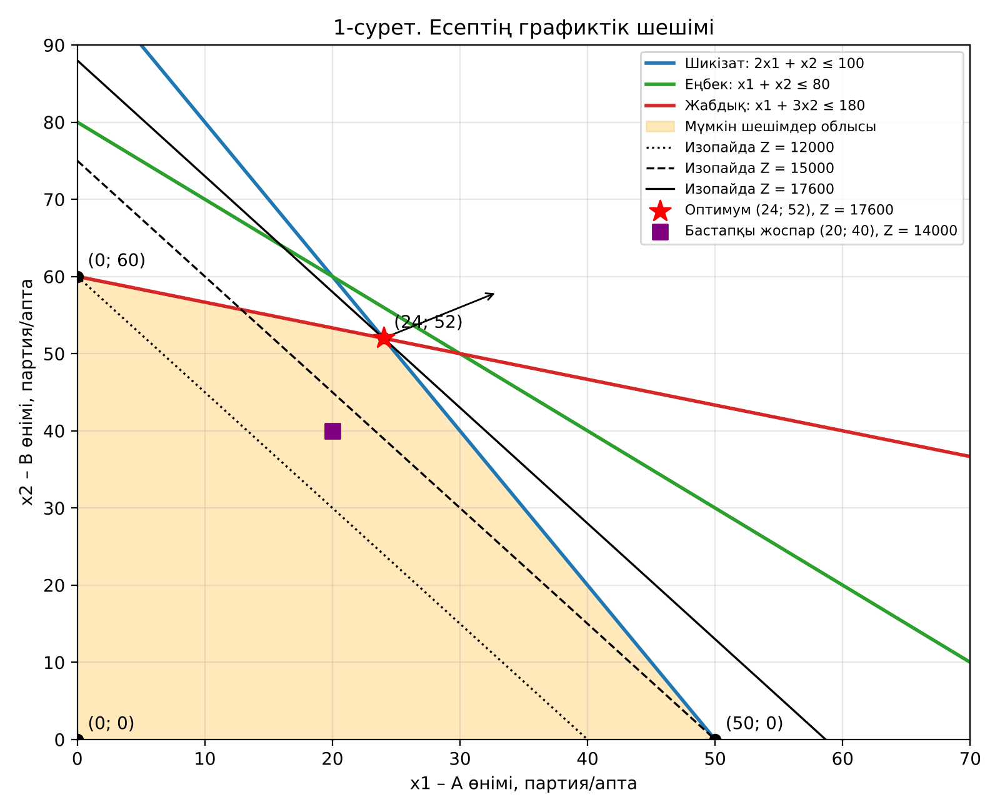
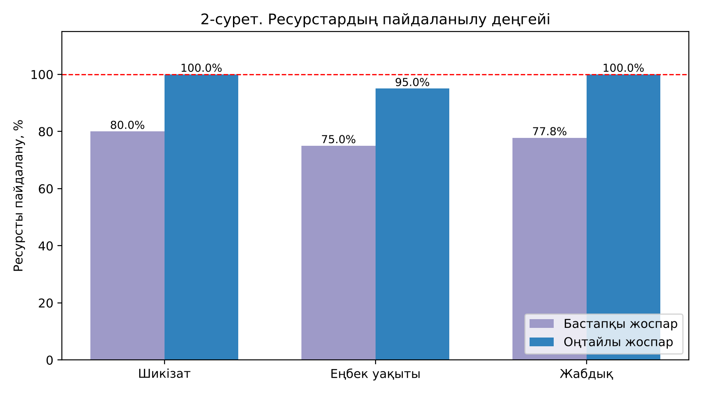
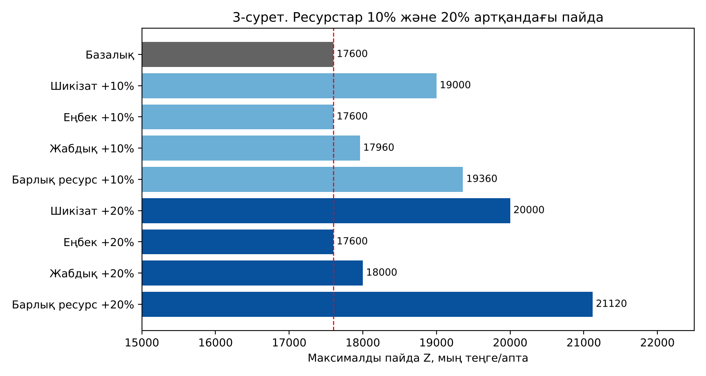
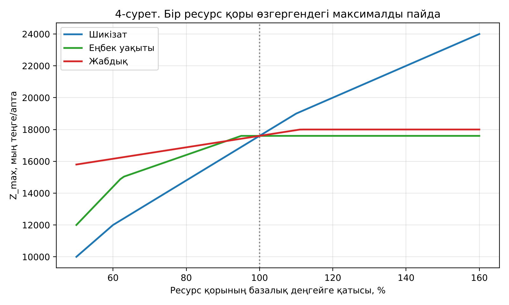

# МАЗМҰНЫ

1. Кіріспе
2. Теориялық бөлім
3. Бастапқы мәліметтер
4. Математикалық модель құру
5. Математикалық шешу (графиктік әдіс, симплекс әдісі, тексеру, бүтінсанды модель)
6. Python арқылы компьютерлік модельдеу
7. Нәтижелерді талдау және сезімталдық зерттеуі
8. Қорытынды
9. Пайдаланылған әдебиеттер
10. Қосымша А. Жұмысты 100 балдық критерий бойынша өзіндік бағалау
11. Қосымша Б. Python бағдарламасының толық мәтіні

# 1. КІРІСПЕ

**Тақырыптың өзектілігі.** Нарықтық экономика жағдайында өндірістік кәсіпорын бәсекеге қабілеттілігін сақтау үшін шектеулі ресурстарды — шикізатты, жұмыс күшінің уақытын, жабдықтың өндірістік қуатын — барынша тиімді бөлуге мәжбүр. Ресурстардың әрқайсысы шектеулі және қымбат болғандықтан, «қай өнімді қанша көлемде шығару керек?» деген сұраққа интуиция немесе өткен кезеңнің тәжірибесі негізінде жауап беру көбінесе пайданың бір бөлігін жоғалтуға әкеледі. Бұл сұраққа дәл, сандық негізделген жауапты экономикалық-математикалық модельдеу, атап айтқанда сызықтық бағдарламалау (СБ) береді. Өндірісті жоспарлаудың СБ есебін алғаш рет 1939 жылы Л. В. Канторович тұжырымдаған, ал оны шешудің әмбебап алгоритмі — симплекс әдісін 1947 жылы Дж. Данциг ұсынған [1; 8]. Бүгінгі таңда бұл әдістер ERP-жүйелердің, өндірісті жоспарлау және логистика бағдарламаларының ішкі математикалық ядросы болып табылады, ал Python тіліндегі SciPy сияқты ашық кітапханалар оларды кез келген кәсіпорынға қолжетімді етеді [9; 12].

**Математикалық және компьютерлік модельдеудің кәсіпорын экономикасындағы рөлі.** Математикалық модель экономикалық объектінің мәнді байланыстарын (ресурс шығындары, баға, пайда) формулалар түрінде сипаттап, басқарушылық шешімді формалды оңтайландыру есебіне айналдырады. Компьютерлік модель осы есепті жылдам шешуге, деректер өзгергенде қайта есептеуге және «егер ... болса, не болады?» сценарийлерін (сезімталдық талдауы) тәжірибе жүргізбей-ақ зерттеуге мүмкіндік береді. Осылайша модельдеу нақты өндірісте қымбат және тәуекелді эксперименттерді арзан әрі қауіпсіз есептеу экспериментімен алмастырады [14; 15].

**Зерттеудің мақсаты** — кәсіпорынның шектеулі өндірістік ресурстарын тиімді пайдалану арқылы максималды пайдаға қол жеткізетін математикалық модель құру, оны симплекс әдісімен шешу және Python тілінде компьютерлік модельдеу арқылы нәтижені тексеріп, экономикалық тұрғыдан талдау.

**Зерттеудің міндеттері:**

1. өндірістік кәсіпорынның ресурстарды бөлу мәселесін зерттеу;
2. екі түрлі өнім өндіретін кәсіпорынның жұмыс жағдайын модельдеу;
3. бастапқы экономикалық деректерді жинау және жүйелеу;
4. пайданы максимизациялайтын математикалық модель құру;
5. есепті сызықтық бағдарламалау (графиктік және симплекс) әдісімен шешу;
6. Python бағдарламалау тілінде компьютерлік модель жасау;
7. математикалық және компьютерлік нәтижелерді салыстыру, экономикалық талдау жүргізу;
8. ресурстар өзгерген кездегі модельдің сезімталдығын зерттеу.

**Зерттеу объектісі** — екі түрлі өнім (А және В) шығаратын шартты өндірістік кәсіпорын.

**Зерттеу пәні** — кәсіпорынның шектеулі ресурстарын өнім түрлері арасында бөлудің пайданы максимизациялайтын математикалық және компьютерлік моделі.

**Зерттеу әдістері:** экономикалық-математикалық модельдеу, сызықтық бағдарламалау, графиктік әдіс, симплекс әдісі, қосарлану теориясы, тармақтар мен шекаралар әдісі (бүтінсанды бағдарламалау), параметрлік және сезімталдық талдауы, Python (NumPy, SciPy, Matplotlib) көмегімен компьютерлік модельдеу.

**Жұмыстың практикалық маңызы.** Құрылған модель мен бағдарлама кез келген «көп өнім – көп ресурс» құрылымды кәсіпорынға деректерді (A матрицасы, b және c векторлары) ауыстыру арқылы ғана қолданыла алады.

# 2. ТЕОРИЯЛЫҚ БӨЛІМ

## 2.1. Экономикалық-математикалық модельдеу ұғымы

*Модель* — зерттелетін объектінің (түпнұсқаның) зерттеу мақсаты үшін маңызды қасиеттерін сақтайтын, оны алмастыратын жүйе. *Математикалық модель* — объектінің элементтері мен олардың арасындағы байланыстарды математикалық символдар, теңдеулер мен теңсіздіктер арқылы сипаттау [14]. *Экономикалық-математикалық модель* — экономикалық объектінің немесе процестің математикалық сипаттамасы; онда экономикалық көрсеткіштер (өнім көлемі, шығын, пайда) айнымалылар мен параметрлер ретінде көрінеді.

Модельдеу келесі кезеңдерден тұрады: (1) экономикалық мәселені қою; (2) ақпарат жинау және жүйелеу; (3) формалдау — айнымалыларды, мақсатты және шектеулерді анықтау; (4) модельді шешу әдісін таңдау және шешу; (5) нәтижені тексеру (верификация және адекваттылық); (6) экономикалық талдау және шешімді енгізу. Осы жұмыстың құрылымы дәл осы кезеңдерге сәйкес келеді.

Модельдер *детерминирленген* және *стохастикалық*, *статикалық* және *динамикалық*, *сызықтық* және *сызықтық емес* болып бөлінеді. Біздің модель — детерминирленген, статикалық (бір апталық жоспарлау кезеңі), сызықтық оңтайландыру моделі.

## 2.2. Компьютерлік модельдеу ұғымы

*Компьютерлік модель* — математикалық модельдің алгоритм және бағдарлама түрінде іске асырылуы, ол ЭЕМ-де есептеу эксперименттерін жүргізуге мүмкіндік береді [15]. Компьютерлік модельдеудің артықшылықтары: (а) үлкен өлшемді есептерді (мыңдаған айнымалы) шешу; (б) қолмен есептеудегі арифметикалық қателерді болдырмау; (в) параметрлерді көп рет өзгертіп, сценарийлерді салыстыру; (г) нәтижелерді графиктік түрде көрнекі ұсыну. Бұл жұмыста компьютерлік модель Python тілінде жасалып, SciPy кітапханасының HiGHS шешушісі (қос симплекс және ішкі нүкте әдістерінің жоғары өнімді іске асырылуы [12]) қолданылды.

## 2.3. Сызықтық бағдарламалау

*Сызықтық бағдарламалау* — мақсаттық функциясы да, шектеулері де айнымалыларға қатысты сызықтық болатын оңтайландыру есептерін шешу әдістерінің бөлімі [1; 2; 4]. Ресурстарды бөлу есебінің жалпы (стандартты) түрі:

$$Z=\sum_{j=1}^{n}c_jx_j\rightarrow\max,\qquad \sum_{j=1}^{n}a_{ij}x_j\le b_i\ (i=\overline{1,m}),\qquad x_j\ge 0\ (j=\overline{1,n}).$$

Матрицалық түрде: $Z=\mathbf{c}^{T}\mathbf{x}\to\max,\ A\mathbf{x}\le\mathbf{b},\ \mathbf{x}\ge\mathbf{0}$, мұндағы $\mathbf{x}$ — өндіріс жоспарының векторы, $\mathbf{c}$ — бірлік пайда векторы, $A=(a_{ij})$ — технологиялық матрица (бір бірлік $j$-өнімге $i$-ресурс шығыны), $\mathbf{b}$ — ресурс қорларының векторы.

Сызықтық модель келесі болжамдарға негізделеді: **пропорционалдық** (шығын мен пайда өндіріс көлеміне тура пропорционал), **аддитивтілік** (жалпы шығын мен пайда өнімдер бойынша қосылады), **бөлінгіштік** (айнымалылар бөлшек мән қабылдай алады) және **детерминирленгендік** (барлық параметрлер белгілі) [3].

## 2.4. Мақсаттық функция

*Мақсаттық функция* $Z(\mathbf{x})$ — шешімнің сапасын бағалайтын сандық критерий. Пайданы максимизациялау есебінде $Z=\sum c_jx_j$, мұндағы $c_j$ — $j$-өнімнің бір бірлігінен алынатын пайда (баға минус айнымалы шығындар). Мақсаттық функцияның деңгей сызықтары $Z=\text{const}$ (*изопайда сызықтары*) өзара параллель түзулер, ал олардың нормаль векторы — градиент $\nabla Z=(c_1,c_2)$ — $Z$-тің ең жылдам өсу бағытын көрсетеді.

## 2.5. Шектеулер жүйесі

Шектеулер жүйесі $A\mathbf{x}\le\mathbf{b}$ ресурстардың жеткіліксіздігін көрсетеді: кез келген $i$-ресурс бойынша жоспардың шығыны $\sum_j a_{ij}x_j$ оның қорынан $b_i$ аспауы тиіс. Теріс емес болу шарты $x_j\ge0$ — өндіріс көлемінің физикалық мағынасынан туындайды. Барлық шектеулерді қанағаттандыратын $\mathbf{x}$ векторы *мүмкін жоспар* деп, ал олардың жиыны $D=\{\mathbf{x}: A\mathbf{x}\le\mathbf{b},\ \mathbf{x}\ge0\}$ *мүмкін шешімдер облысы* деп аталады. $D$ — дөңес көпжақ (екі өлшемде — дөңес көпбұрыш).

Теңсіздікті теңдікке келтіру үшін теріс емес *қосымша (балансты) айнымалы* $s_i\ge0$ енгізіледі: $\sum_j a_{ij}x_j+s_i=b_i$. Экономикалық мағынасы — $i$-ресурстың пайдаланылмаған қалдығы.

## 2.6. Оптимизация және оптималды шешім

*Оптимизация* — мүмкін шешімдер облысынан мақсаттық функцияға экстремум беретін нүктені іздеу. $\mathbf{x}^*\in D$ нүктесі *оптималды шешім* деп аталады, егер барлық $\mathbf{x}\in D$ үшін $Z(\mathbf{x}^*)\ge Z(\mathbf{x})$.

**СБ-ның негізгі теоремасы.** Егер СБ есебінің шектелген оптималды шешімі бар болса, онда ол мүмкін шешімдер облысының ең болмағанда бір төбесінде (бұрыштық нүктесінде) қабылданады [4; 5]. *Негіздемесі:* $Z$ сызықтық, сондықтан дөңес функция; дөңес көпжақтың кез келген нүктесі төбелерінің дөңес комбинациясы $\mathbf{x}=\sum\lambda_k\mathbf{v}_k$ ($\lambda_k\ge0,\ \sum\lambda_k=1$) болып табылады, демек $Z(\mathbf{x})=\sum\lambda_kZ(\mathbf{v}_k)\le\max_kZ(\mathbf{v}_k)$. Осыдан оптимумды тек төбелер арасынан іздеу жеткілікті екені шығады — бұл симплекс әдісінің іргетасы.

**Қосарлану теориясы.** Әрбір тура (максимизация) есебіне қосарланған есеп сәйкес келеді:
$$W=\mathbf{b}^{T}\mathbf{y}\to\min,\qquad A^{T}\mathbf{y}\ge\mathbf{c},\qquad \mathbf{y}\ge\mathbf{0}.$$
Мұндағы $y_i$ — $i$-ресурстың *көлеңкелі (объективті шартты) бағасы*: $b_i$ бір бірлікке артқанда максималды пайданың өсімі, $y_i=\partial Z^*/\partial b_i$. Қосарланудың бірінші теоремасы бойынша, екі есептің де оптимумдары бар болса, $Z^*=W^*$. Толықтауыш бос емес шарттары: $y_i\,s_i=0$ — қалдығы бар ресурстың көлеңкелі бағасы нөлге тең, ал көлеңкелі бағасы оң ресурс толық пайдаланылады (тапшы ресурс) [1; 8].

## 2.7. Симплекс әдісінің теориялық негіздері

Симплекс әдісі — мүмкін шешімдер көпжағының бір төбесінен (базистік шешімнен) көрші төбесіне мақсаттық функция кемімейтіндей етіп реттелген өту [1; 2]. Әдістің негізгі ұғымдары мен ережелері:

1. **Канондық түр.** Қосымша айнымалылар енгізу арқылы $A\mathbf{x}+\mathbf{s}=\mathbf{b}$. Егер $\mathbf{b}\ge0$ болса, бастапқы базистік мүмкін шешім: $\mathbf{x}=0,\ \mathbf{s}=\mathbf{b}$ (координаттар басы).
2. **Базистік шешім.** $m$ теңдеудің $n+m$ айнымалысының ішінен $m$ *базистік* айнымалы таңдалады, қалған $n$ *бос* айнымалы нөлге теңестіріледі. Әр базистік мүмкін шешімге көпжақтың бір төбесі сәйкес келеді.
3. **Бағалау жолы (Z-жолы).** Мақсаттық функцияны $Z-\sum c_jx_j=0$ түрінде жазып, кестенің соңғы жолына $\Delta_j=-c_j$ коэффициенттері енгізіледі. Жалпы жағдайда $\Delta_j=\mathbf{c}_B^{T}B^{-1}A_j-c_j$, мұндағы $B$ — базис матрицасы.
4. **Оптималдық шарты (максимум үшін):** барлық $\Delta_j\ge0$. Егер $\Delta_k<0$ болса, $x_k$-ны базиске енгізу $Z$-ті $|\Delta_k|$ жылдамдықпен арттырады.
5. **Енгізілетін айнымалы (шешуші баған):** $k=\arg\min_j\Delta_j$ (ең теріс баға — Данциг ережесі).
6. **Шығарылатын айнымалы (шешуші жол)** — ең кіші симплекс қатынасы бойынша:
$$\theta=\min_{i:\ a_{ik}>0}\frac{b_i}{a_{ik}}.$$
Бұл ереже жаңа шешімнің мүмкіндігін ($\mathbf{b}\ge0$) сақтайды: $x_k$ мәні $\theta$-дан асса, қандай да бір базистік айнымалы теріс болып кетер еді. Егер шешуші бағанда оң элемент болмаса, $Z$ шектелмеген.
7. **Тірек (шешуші) элемент** $a_{rk}$ — шешуші жол мен бағанның қиылысуындағы элемент. **Жордан–Гаусс түрлендіруі:** шешуші жол тірек элементке бөлінеді, $a'_{rj}=a_{rj}/a_{rk}$; қалған жолдар (Z-жолын қоса) «тіктөртбұрыш ережесімен» есептеледі:
$$a'_{ij}=a_{ij}-\frac{a_{ik}\,a_{rj}}{a_{rk}},\qquad i\ne r.$$
8. **Мақсаттық функцияның өсімі** бір итерацияда $\Delta Z=-\Delta_k\cdot\theta\ge0$.

Әр итерацияда $Z$ кемімейді және төбелер саны шектеулі болғандықтан ($\le C_{n+m}^{m}$), азғындалмаған жағдайда әдіс шектеулі қадамнан кейін оптимумға жетеді. Соңғы кестедегі қосымша айнымалылардың $\Delta$ бағалары қосарланған есептің шешімін — көлеңкелі бағаларды береді.

# 3. БАСТАПҚЫ МӘЛІМЕТТЕР

> **Ескерту.** Жұмыста **шартты (оқу мақсатындағы) деректер** қолданылды. Олар нақты кәсіпорынның статистикасы емес, бірақ шамалары жеңіл өнеркәсіп/тамақ өнеркәсібі кәсіпорнына тән болатындай етіп таңдалды. Нақты кәсіпорынға қолданғанда кестедегі сандарды кәсіпорынның технологиялық карталарынан, нормативтік шығын нормаларынан және бухгалтерлік есеп деректерінен алу қажет.

Кәсіпорын екі өнім шығарады: **А өнімі** және **В өнімі**. Жоспарлау кезеңі — 1 апта. Өлшем бірлігі — партия (1 партия = 100 дана). Өндіріс үш ресурспен шектеледі: шикізат, жұмысшылардың еңбек уақыты және жабдықтың (станоктардың) жұмыс уақыты.

**1-кесте. Ресурс шығыны нормалары, ресурс қорлары және өнім пайдасы**

| Ресурс | Өлшем бірлігі | А өнімі (1 партияға) | В өнімі (1 партияға) | Апталық қор |
|:---|:---|:---:|:---:|:---:|
| Шикізат | тонна | 2 | 1 | 100 |
| Еңбек уақыты | жүз адам-сағат | 1 | 1 | 80 |
| Жабдық жұмысы | станок-сағат | 1 | 3 | 180 |
| **Бірлік пайда** | мың теңге/партия | **300** | **200** | — |

**Деректердің экономикалық түсіндірмесі:**

- А өнімі — шикізатты көп қажет ететін (2 т/партия), бірақ жабдықты аз қажет ететін, пайдасы жоғары өнім (300 мың тг);
- В өнімі — шикізатты аз (1 т), бірақ жабдықтың уақытын көп (3 станок-сағ) қажет ететін өнім;
- еңбек уақытының қоры 80 жүз адам-сағат = 8 000 адам-сағат/апта, бұл 40 сағаттық жұмыс аптасында 200 жұмысшыға сәйкес;
- жабдық қоры 180 станок-сағат/апта (мысалы, 40 сағаттан жұмыс істейтін 4,5 станокқа балама);
- бірлік пайда = (партияның сату бағасы) − (партияға кететін айнымалы шығындар); тұрақты шығындар жоспар құрылымына тәуелді болмағандықтан, оңтайлы жоспарға әсер етпейді.

**2-кесте. Кәсіпорынның қазіргі (бастапқы) өндіріс жоспары**

| Көрсеткіш | А өнімі | В өнімі | Барлығы |
|:---|:---:|:---:|:---:|
| Өндіріс көлемі, партия/апта | 20 | 40 | 60 |
| Пайда, мың тг/апта | 6 000 | 8 000 | 14 000 |

Бастапқы жоспар кәсіпорын басшылығының өткен кезең тәжірибесіне сүйеніп қабылданған деп алынды; ол модельдің тиімділігін бағалау үшін салыстыру базасы қызметін атқарады.

# 4. МАТЕМАТИКАЛЫҚ МОДЕЛЬ ҚҰРУ

## 4.1. Белгісіз айнымалыларды енгізу

- $x_1$ — А өнімінің апталық өндіріс көлемі, партия;
- $x_2$ — В өнімінің апталық өндіріс көлемі, партия.

Өндіріс жоспары $\mathbf{x}=(x_1,x_2)$ векторымен беріледі.

## 4.2. Мақсаттық функцияны құру

А өнімінің бір партиясы 300 мың тг пайда әкелсе, $x_1$ партиядан пайда $300x_1$ (пропорционалдық болжамы). Сол сияқты В өнімінен — $200x_2$. Аддитивтілік болжамы бойынша жалпы пайда:

$$Z=300x_1+200x_2\rightarrow\max\quad(\text{мың теңге/апта}).$$

Мұнда $c_1=300$, $c_2=200$ — өнімдердің бірлік пайдасы.

## 4.3. Ресурстық шектеулер

*Шикізат.* Бір партия А-ға 2 т, В-ға 1 т шикізат жұмсалады; $x_1$ және $x_2$ партияға жалпы шығын $2x_1+1\cdot x_2$ тонна. Бұл апталық қордан (100 т) аспауы тиіс:
$$2x_1+x_2\le100.$$

*Еңбек уақыты.* Әр өнімнің бір партиясына 1 жүз адам-сағат:
$$x_1+x_2\le80.$$

*Жабдық.* А партиясына 1, В партиясына 3 станок-сағат:
$$x_1+3x_2\le180.$$

## 4.4. Теріс емес болу шарттары

Өндіріс көлемі теріс бола алмайды:
$$x_1\ge0,\qquad x_2\ge0.$$

## 4.5. Толық математикалық модель

$$
\begin{aligned}
&Z=300x_1+200x_2\rightarrow\max,\\
&\begin{cases}
2x_1+x_2\le100 & \text{(шикізат, т)},\\
x_1+x_2\le80 & \text{(еңбек, жүз адам-сағ)},\\
x_1+3x_2\le180 & \text{(жабдық, станок-сағ)},\\
x_1\ge0,\ x_2\ge0.
\end{cases}
\end{aligned}
$$

Матрицалық түрде:
$$\mathbf{c}=\begin{pmatrix}300\\200\end{pmatrix},\quad A=\begin{pmatrix}2&1\\1&1\\1&3\end{pmatrix},\quad \mathbf{b}=\begin{pmatrix}100\\80\\180\end{pmatrix}.$$

**3-кесте. Модель коэффициенттерінің экономикалық мағынасы**

| Белгі | Мәні | Экономикалық мағынасы |
|:---:|:---:|:---|
| $c_1$ | 300 | А өнімінің 1 партиясынан пайда, мың тг |
| $c_2$ | 200 | В өнімінің 1 партиясынан пайда, мың тг |
| $a_{11},a_{12}$ | 2; 1 | 1 партия А / В өндіруге шикізат шығыны, т |
| $a_{21},a_{22}$ | 1; 1 | 1 партия А / В өндіруге еңбек шығыны, жүз адам-сағ |
| $a_{31},a_{32}$ | 1; 3 | 1 партия А / В өндіруге жабдық уақыты, станок-сағ |
| $b_1$ | 100 | Апталық шикізат қоры, т |
| $b_2$ | 80 | Апталық еңбек уақытының қоры, жүз адам-сағ |
| $b_3$ | 180 | Жабдықтың апталық жұмыс уақытының қоры, станок-сағ |

# 5. МАТЕМАТИКАЛЫҚ ШЕШУ

## 5.1. Графиктік әдіс (шешімнің геометриялық түсіндірмесі)

Екі айнымалы болғандықтан, есепті алдымен графиктік түрде шешіп, симплекс әдісінің нәтижесін тексеруге болады.

*1-қадам — шекаралық түзулер.* Әр теңсіздікті теңдікке айналдырып, осьтермен қиылысу нүктелерін табамыз:

- $L_1: 2x_1+x_2=100$ — нүктелер $(50;0)$ және $(0;100)$;
- $L_2: x_1+x_2=80$ — нүктелер $(80;0)$ және $(0;80)$;
- $L_3: x_1+3x_2=180$ — нүктелер $(180;0)$ және $(0;60)$.

$(0;0)$ нүктесі барлық теңсіздікті қанағаттандыратындықтан, әр жартыжазықтық координаттар басы жағында жатыр.

*2-қадам — мүмкін шешімдер облысының төбелері.* Төбелер — шекаралық түзулердің қиылысулары:

- $O(0;0)$;
- $L_1\cap Ox_1$: $x_2=0\Rightarrow x_1=50$, $P_1(50;0)$; тексеру: $L_2$: $50\le80$, $L_3$: $50\le180$ — мүмкін;
- $L_1\cap L_3$: $L_1$-ден $x_2=100-2x_1$; $L_3$-ке қойсақ: $x_1+3(100-2x_1)=180\Rightarrow 300-5x_1=180\Rightarrow x_1=24$, $x_2=100-48=52$. $P_2(24;52)$; тексеру: $L_2$: $24+52=76\le80$ — мүмкін;
- $L_3\cap Ox_2$: $x_1=0\Rightarrow x_2=60$, $P_3(0;60)$; тексеру: $L_1$: $60\le100$, $L_2$: $60\le80$ — мүмкін.

Қалған қиылысулар мүмкін облыстан тыс жатады: $L_1\cap L_2=(20;60)$ — $L_3$ бойынша $20+180=200>180$; $L_2\cap L_3=(30;50)$ — $L_1$ бойынша $60+50=110>100$. Демек $L_2$ (еңбек) түзуі мүмкін облыстың шекарасын құрмайды — бұл еңбек ресурсының артық екенін алдын ала көрсетеді.

*3-қадам — төбелердегі мақсаттық функция мәндері.*

**4-кесте. Мүмкін шешімдер облысы төбелеріндегі пайда**

| Төбе | $x_1$ | $x_2$ | $Z=300x_1+200x_2$, мың тг |
|:---:|:---:|:---:|:---:|
| $O$ | 0 | 0 | 0 |
| $P_1$ | 50 | 0 | 15 000 |
| $P_2$ | 24 | 52 | **17 600** |
| $P_3$ | 0 | 60 | 12 000 |

*4-қадам — изопайда сызығы.* Градиент $\nabla Z=(300;200)$. $Z=\text{const}$ түзуін градиент бағытымен жылжытқанда ол мүмкін облыстан $P_2(24;52)$ нүктесінде соңғы рет шығады (1-сурет). Сонымен $x_1^*=24,\ x_2^*=52,\ Z^*=17\,600$.



*Оптимумның геометриялық шарты.* Изопайда түзуінің еңісі $-c_1/c_2=-1{,}5$. Ол $L_1$ еңісі ($-2$) мен $L_3$ еңісі ($-1/3$) арасында жатыр: $-2<-1{,}5<-1/3$. Сондықтан оптимум осы екі түзудің қиылысында орналасады.

## 5.2. Симплекс әдісімен кезең-кезеңімен шешу

### 5.2.1. Есепті канондық түрге келтіру

Әр теңсіздікке теріс емес қосымша айнымалы ($s_1$ — шикізат қалдығы, $s_2$ — еңбек уақытының қалдығы, $s_3$ — жабдық уақытының қалдығы) қосамыз:

$$
\begin{cases}
2x_1+x_2+s_1=100,\\
x_1+x_2+s_2=80,\\
x_1+3x_2+s_3=180,\\
x_1,x_2,s_1,s_2,s_3\ge0;
\end{cases}
\qquad Z-300x_1-200x_2=0.
$$

Қосымша айнымалылар пайдаға әсер етпейді, сондықтан олардың $Z$-тегі коэффициенттері нөлге тең. Бастапқы базис $\{s_1,s_2,s_3\}$, бос айнымалылар $x_1=x_2=0$. Бастапқы базистік шешім: $(x_1,x_2,s_1,s_2,s_3)=(0;0;100;80;180)$, $Z=0$ — бұл $O(0;0)$ төбесі (өндіріс жоқ, барлық ресурс бос).

### 5.2.2. 0-итерация (бастапқы симплекс кестесі)

**5-кесте. Бастапқы симплекс кестесі**

| Базис | $c_B$ | $x_1$ | $x_2$ | $s_1$ | $s_2$ | $s_3$ | $b$ | $\theta=b_i/a_{i1}$ |
|:---:|:---:|:---:|:---:|:---:|:---:|:---:|:---:|:---:|
| $s_1$ | 0 | **[2]** | 1 | 1 | 0 | 0 | 100 | 100/2 = **50** (min) |
| $s_2$ | 0 | 1 | 1 | 0 | 1 | 0 | 80 | 80/1 = 80 |
| $s_3$ | 0 | 1 | 3 | 0 | 0 | 1 | 180 | 180/1 = 180 |
| $\Delta_j$ (Z) | | **−300** | −200 | 0 | 0 | 0 | 0 | |

*Оптималдық тексеру:* $\Delta_1=-300<0$, $\Delta_2=-200<0$ — жоспар оптималды емес.

*Шешуші баған:* $\min\{-300;-200\}=-300\Rightarrow x_1$ базиске енеді (А өнімінің бір партиясы пайданы ең көп — 300 мың тг-ге арттырады).

*Шешуші жол:* $\theta=\min\{50;80;180\}=50$ — бірінші жол, $s_1$ базистен шығады (шикізат алғашқы болып таусылады).

*Тірек элементі:* $a_{11}=2$.

### 5.2.3. 1-итерация

**Шешуші жолды түрлендіру** (тірек элементке бөлу, $R_1'=R_1/2$):
$$x_1+\tfrac12x_2+\tfrac12s_1=50.$$

**Қалған жолдар** ($R_i'=R_i-a_{i1}R_1'$):

- $R_2'=R_2-1\cdot R_1'$: $(1-1)x_1+(1-\tfrac12)x_2+(0-\tfrac12)s_1+s_2=80-50$, яғни $\tfrac12x_2-\tfrac12s_1+s_2=30$;
- $R_3'=R_3-1\cdot R_1'$: $(3-\tfrac12)x_2-\tfrac12s_1+s_3=180-50$, яғни $\tfrac52x_2-\tfrac12s_1+s_3=130$;
- $Z'=Z-(-300)R_1'$: $\Delta_2=-200+300\cdot\tfrac12=-50$; $\Delta_{s_1}=0+300\cdot\tfrac12=150$; $Z=0+300\cdot50=15\,000$.

Тіктөртбұрыш ережесімен тексеру, мысалы $a'_{32}=a_{32}-\dfrac{a_{31}a_{12}}{a_{11}}=3-\dfrac{1\cdot1}{2}=\dfrac52$ — сәйкес.

**6-кесте. 1-итерациядан кейінгі симплекс кестесі**

| Базис | $c_B$ | $x_1$ | $x_2$ | $s_1$ | $s_2$ | $s_3$ | $b$ | $\theta=b_i/a_{i2}$ |
|:---:|:---:|:---:|:---:|:---:|:---:|:---:|:---:|:---:|
| $x_1$ | 300 | 1 | 1/2 | 1/2 | 0 | 0 | 50 | 50/(1/2) = 100 |
| $s_2$ | 0 | 0 | 1/2 | −1/2 | 1 | 0 | 30 | 30/(1/2) = 60 |
| $s_3$ | 0 | 0 | **[5/2]** | −1/2 | 0 | 1 | 130 | 130/(5/2) = **52** (min) |
| $\Delta_j$ (Z) | | 0 | **−50** | 150 | 0 | 0 | 15 000 | |

Базистік шешім: $(50;0;0;30;130)$, $Z=15\,000$ — бұл $P_1(50;0)$ төбесі. $Z$ өсімі: $\Delta Z=-\Delta_1\cdot\theta=300\cdot50=15\,000$.

*Оптималдық тексеру:* $\Delta_2=-50<0$ — жоспарды әлі жақсартуға болады. Экономикалық мағынасы: В өнімінің бір партиясын енгізу оның өз пайдасын (200) береді, бірақ шикізатты босату үшін А-ны 1/2 партияға қысқарту керек (−150), таза өсім $200-150=50$ мың тг.

*Шешуші баған:* $x_2$. *Шешуші жол:* $\theta=\min\{100;60;52\}=52$ — үшінші жол, $s_3$ базистен шығады (жабдық уақыты таусылады). *Тірек элементі:* $a_{32}=5/2$.

### 5.2.4. 2-итерация

**Шешуші жол** ($R_3''=R_3'\cdot\tfrac25$):
$$x_2-\tfrac15s_1+\tfrac25s_3=52.$$

**Қалған жолдар:**

- $R_1''=R_1'-\tfrac12R_3''$: $x_1+\left(\tfrac12+\tfrac1{10}\right)s_1-\tfrac15s_3=50-26$, яғни $x_1+\tfrac35s_1-\tfrac15s_3=24$;
- $R_2''=R_2'-\tfrac12R_3''$: $\left(-\tfrac12+\tfrac1{10}\right)s_1+s_2-\tfrac15s_3=30-26$, яғни $-\tfrac25s_1+s_2-\tfrac15s_3=4$;
- $Z''=Z'+50R_3''$: $\Delta_{s_1}=150+50\cdot\left(-\tfrac15\right)=140$; $\Delta_{s_3}=0+50\cdot\tfrac25=20$; $Z=15\,000+50\cdot52=17\,600$.

**7-кесте. Соңғы (оптималды) симплекс кестесі**

| Базис | $c_B$ | $x_1$ | $x_2$ | $s_1$ | $s_2$ | $s_3$ | $b$ |
|:---:|:---:|:---:|:---:|:---:|:---:|:---:|:---:|
| $x_1$ | 300 | 1 | 0 | 3/5 | 0 | −1/5 | **24** |
| $s_2$ | 0 | 0 | 0 | −2/5 | 1 | −1/5 | **4** |
| $x_2$ | 200 | 0 | 1 | −1/5 | 0 | 2/5 | **52** |
| $\Delta_j$ (Z) | | 0 | 0 | **140** | 0 | **20** | **17 600** |

$Z$ өсімі: $\Delta Z=50\cdot52=2\,600$ ($15\,000\to17\,600$).

*Оптималдық шарты:* барлық $\Delta_j\ge0$ ($0;0;140;0;20$) — **жоспар оптималды**. Бос айнымалылардың ($s_1,s_3$) бағалары қатаң оң, сондықтан оптимум жалғыз.

**8-кесте. Симплекс итерацияларының қорытындысы**

| Итерация | Базис | Төбе $(x_1;x_2)$ | Енгізілетін / шығарылатын | Тірек элементі | $Z$, мың тг | $\Delta Z$ |
|:---:|:---:|:---:|:---:|:---:|:---:|:---:|
| 0 | $s_1,s_2,s_3$ | (0; 0) | $x_1$ / $s_1$ | 2 | 0 | — |
| 1 | $x_1,s_2,s_3$ | (50; 0) | $x_2$ / $s_3$ | 5/2 | 15 000 | +15 000 |
| 2 | $x_1,s_2,x_2$ | (24; 52) | — (оптимум) | — | 17 600 | +2 600 |

Симплекс әдісі графиктегі $O\to P_1\to P_2$ жолымен көрші төбелер бойынша жүрді — бұл 2.7-бөлімдегі теорияның нақты көрінісі.

### 5.2.5. Оптималды шешім

$$x_1^*=24,\quad x_2^*=52,\quad s_1^*=0,\quad s_2^*=4,\quad s_3^*=0,\quad Z^*=17\,600\ \text{мың тг/апта}.$$

Қосарланған есептің шешімі (көлеңкелі бағалар) соңғы кестедегі $s_i$ бағандарының $\Delta$ мәндері: $y_1^*=140$, $y_2^*=0$, $y_3^*=20$.

## 5.3. Оңтайлы шешімді тексеру

**(1) Шектеулерге қою (мүмкіндік):**

- шикізат: $2\cdot24+52=100\le100$ — толық пайдаланылды;
- еңбек: $24+52=76\le80$ — қалдық 4;
- жабдық: $24+3\cdot52=180\le180$ — толық пайдаланылды;
- $x_1=24\ge0,\ x_2=52\ge0$.

**(2) Мақсаттық функция:** $Z=300\cdot24+200\cdot52=7\,200+10\,400=17\,600$.

**(3) Қосарланған есеп арқылы тексеру.** Қосарланған есеп:
$$W=100y_1+80y_2+180y_3\to\min,\quad
\begin{cases}2y_1+y_2+y_3\ge300,\\ y_1+y_2+3y_3\ge200,\\ y_1,y_2,y_3\ge0.\end{cases}$$
$\mathbf{y}^*=(140;0;20)$ қойсақ: $2\cdot140+0+20=300\ge300$ ✓; $140+0+60=200\ge200$ ✓ — мүмкін. $W^*=100\cdot140+80\cdot0+180\cdot20=14\,000+3\,600=17\,600=Z^*$. Қосарланудың бірінші теоремасы бойынша, тура және қосарланған мүмкін шешімдер үшін $Z=W$ теңдігі екеуінің де оптималдығын дәлелдейді.

**(4) Толықтауыш бос емес шарттары:** $y_1s_1=140\cdot0=0$, $y_2s_2=0\cdot4=0$, $y_3s_3=20\cdot0=0$ ✓.

**(5) Графиктік әдіспен сәйкестік:** 4-кесте бойынша да оптимум $P_2(24;52)$, $Z=17\,600$ ✓.

## 5.4. Бүтінсанды модельдің қажеттілігі

Егер өнім бөлінбейтін бірліктермен (дана, партия) шығарылатын болса, моделге қосымша **бүтінсандылық шарты** енгізіледі:
$$x_1,x_2\in\mathbb{Z}_{\ge0}.$$
Мұндай есеп *бүтінсанды сызықтық бағдарламалау* (ЖСБ, ағылш. ILP/MILP) деп аталады [6]. Оның мүмкін шешімдер жиыны — дөңес көпбұрыштың ішіндегі бүтін нүктелер торы, ол дөңес емес, сондықтан симплекс әдісі тікелей қолданылмайды. Үздіксіз есептің шешімін жай дөңгелектеу (а) мүмкін емес жоспар беруі немесе (б) оңтайлы емес жоспар беруі мүмкін. Бүтінсанды есептер *тармақтар мен шекаралар* (Ленд–Дойг) немесе *Гомори кесу* әдістерімен шешіледі. Үздіксіз есептің оптимумы бүтінсанды есептің оптимумына жоғарғы шек болып табылады: $Z^*_{\text{бүтін}}\le Z^*_{\text{ЖЗБ}}$.

**Базалық есеп үшін** үздіксіз оптимум $(24;52)$ өзі бүтін, сондықтан бүтінсанды оптимум онымен сәйкес келеді: $Z^*_{\text{бүтін}}=17\,600$.

**Айырмашылықты көрсету үшін** барлық ресурс 10% артқан сценарийді ($\mathbf{b}=(110;88;198)$) қарастырамыз. Үздіксіз оптимум $L_1\cap L_3$ қиылысында: $x_2=110-2x_1$, $x_1+3(110-2x_1)=198\Rightarrow x_1=26{,}4$, $x_2=57{,}2$, $Z=19\,360$ — бөлшек шешім. Тармақтар мен шекаралар әдісін қолданамыз:

- *1-тармақ* $x_1\le26$. $x_1$ кеміген сайын жабдық шектеуі бойымен $Z$ кемиді, сондықтан $x_1=26$, $x_2=\min\{110-52;\ (198-26)/3\}=\min\{58;\ 57{,}33\}=57{,}33$, $Z=7\,800+11\,466{,}7=19\,266{,}7$ (бөлшек, жоғарғы шек $19\,266{,}7$).
- *2-тармақ* $x_1\ge27$. Шикізат шектеуі бойымен $x_1$ артқанда $Z$ өзгерісі $300-2\cdot200=-100<0$, сондықтан $x_1=27$, $x_2=\min\{110-54;\ (198-27)/3\}=\min\{56;57\}=56$, $Z=8\,100+11\,200=19\,300$ — **бүтін шешім**; еңбек: $27+56=83\le88$ ✓.
- 1-тармақтың шегі $19\,266{,}7<19\,300$, сондықтан ол кесіледі (одан жақсы бүтін шешім шықпайды).

Бүтінсанды оптимум: $(27;56)$, $Z^*_{\text{бүтін}}=19\,300$. Үздіксіз шешімнен айырма $19\,360-19\,300=60$ мың тг (0,31%). Ал жай дөңгелектеу $(26;57)$ мүмкін жоспар береді, бірақ $Z=19\,200$, яғни оптималдан 100 мың тг кем. Бұл нәтиже Python-дағы `scipy.optimize.milp` шешімімен толық сәйкес келеді (7.6-бөлім, 12-кесте).

# 6. PYTHON АРҚЫЛЫ КОМПЬЮТЕРЛІК МОДЕЛЬДЕУ

## 6.1. Бағдарламаның құрылымы

Компьютерлік модель `optimization_model.py` файлында жүзеге асырылды (толық мәтіні — Б қосымшасында). Қолданылған кітапханалар: **NumPy** — векторлар мен матрицалармен жұмыс [10]; **SciPy** (`scipy.optimize.linprog`, `milp`) — сызықтық және бүтінсанды бағдарламалау есептерін HiGHS шешушісімен шешу [9; 12; 13]; **Matplotlib** — графиктер [11]; стандартты `fractions` модулі — симплекс кестелерін дәл бөлшектермен есептеу. Іске қосу: `pip install numpy scipy matplotlib`, содан соң `python optimization_model.py`. Бағдарлама Python 3.10+ және SciPy ≥ 1.9 нұсқаларында тексерілді.

## 6.2. Кодтың негізгі бөліктері және түсіндірмесі

**1) Бастапқы деректерді енгізу.** 1-кестедегі деректер NumPy массивтеріне жазылады: `c` — бірлік пайда векторы, `A` — технологиялық матрица (жолдар — ресурстар, бағандар — өнімдер), `b` — ресурс қорлары, `x_base` — салыстыруға арналған бастапқы жоспар.

```python
c = np.array([300.0, 200.0])          # 1 партияның пайдасы, мың теңге
A = np.array([[2.0, 1.0],             # шикізат шығыны, т/партия
              [1.0, 1.0],             # еңбек шығыны, жүз адам-сағ/партия
              [1.0, 3.0]])            # жабдық уақыты, станок-сағ/партия
b = np.array([100.0, 80.0, 180.0])    # апталық ресурс қоры
x_base = np.array([20.0, 40.0])       # кәсіпорынның бастапқы жоспары
```

**2) Мақсаттық функция, шектеулер және оптимизацияны іске қосу.** `linprog` функциясы тек *минимумды* іздейді, сондықтан $\max\,\mathbf{c}^T\mathbf{x}$ есебі $\min(-\mathbf{c})^T\mathbf{x}$ түрінде беріледі, ал нәтиженің таңбасы кері ауыстырылады. `A_ub`, `b_ub` — $A\mathbf{x}\le\mathbf{b}$ шектеулері, `bounds` — $x_j\ge0$ шарттары, `method="highs"` — HiGHS симплекс шешушісі.

```python
def solve_lp(c, A, b):
    res = linprog(-c, A_ub=A, b_ub=b, bounds=[(0, None)] * len(c), method="highs")
    x = res.x                         # оңтайлы жоспар
    z = -res.fun                      # максималды пайда
    used = A @ x                      # пайдаланылған ресурс
    slack = b - used                  # ресурс қалдығы
    shadow = -res.ineqlin.marginals   # көлеңкелі бағалар y_i
    return x, z, used, slack, shadow
```

`res.ineqlin.marginals` — шектеулердің Лагранж көбейткіштері (минимизация есебі үшін $\partial(-Z)/\partial b_i$); таңбасын ауыстырғанда тура көлеңкелі бағалар $y_i=\partial Z^*/\partial b_i$ шығады.

**3) Өзіндік симплекс алгоритмі.** 5.2-бөлімдегі қолмен есептеуді автоматты түрде тексеру үшін `simplex_tableau` функциясы жазылды. Ол дәл бөлшектермен (`Fraction`) жұмыс істейді, сондықтан нәтиже қолмен есептеудегі 1/2, 5/2, 3/5 сияқты бөлшектермен тура сәйкес шығады. Алгоритм: Z-жолындағы ең теріс $\Delta_j$ бойынша шешуші бағанды таңдау → ең кіші $\theta$ бойынша шешуші жолды таңдау → Жордан–Гаусс түрлендіруі → барлық $\Delta_j\ge0$ болғанша қайталау.

```python
col = min(range(n + m), key=lambda j: T[m][j])     # ең теріс Δj
if T[m][col] >= 0: break                           # оптималдық шарты
ratios = [(T[i][-1] / T[i][col], i) for i in range(m) if T[i][col] > 0]
_, row = min(ratios)                               # ең кіші θ
piv = T[row][col]                                  # тірек элемент
T[row] = [v / piv for v in T[row]]                 # шешуші жолды бөлу
for i in range(m + 1):                             # қалған жолдарды нөлдеу
    if i != row and T[i][col] != 0:
        k = T[i][col]
        T[i] = [vi - k * vr for vi, vr in zip(T[i], T[row])]
```

**4) Бүтінсанды модель.** `milp` функциясында `integrality=np.ones(2)` параметрі екі айнымалының да бүтін болуын талап етеді; HiGHS бұл есепті тармақтар мен шекаралар әдісімен шешеді.

```python
res = milp(-c, constraints=LinearConstraint(A, -np.inf, b),
           integrality=np.ones(len(c)), bounds=Bounds(0, np.inf))
```

**5) Ресурстарды пайдалану және сезімталдық.** Әр сценарий үшін $\mathbf{b}$ векторының тиісті компоненті 1,1 немесе 1,2 есе көбейтіліп, есеп қайта шешіледі; тапшы ресурстар қалдығы нөлге тең шектеулер ретінде анықталады. Параметрлік талдауда $b_i$ базалық деңгейдің 50–160%-ы аралығында 111 нүктеде өзгертіліп, $Z^*(b_i)$ тәуелділігі тұрғызылады.

**6) Графиктер.** Matplotlib арқылы төрт график салынып, `figures/` қалтасына PNG форматында сақталады: мүмкін шешімдер облысы (1-сурет), ресурстарды пайдалану (2-сурет), сценарийлер бойынша пайда (3-сурет), параметрлік талдау (4-сурет). Барлық графиктер бағдарлама есептеген нақты нәтижелерден тұрғызылады.

## 6.3. Бағдарламаның шығару нәтижесі

Бағдарламаны іске қосқандағы консольдік нәтиже (үзінді):

```text
===== ОҢТАЙЛЫ ШЕШІМ (SciPy / HiGHS) =====
x1 = 24.0000,  x2 = 52.0000,  Z_max = 17600.00 мың теңге
  Шикізат, т        пайдаланылды 100.00 / 100.00 (100.00%), қалдық 0.00, y = 140.00 -> ШЕКТЕУШІ
  Еңбек уақыты      пайдаланылды  76.00 /  80.00 ( 95.00%), қалдық 4.00, y =   0.00 -> артық қалдық бар
  Жабдық            пайдаланылды 180.00 / 180.00 (100.00%), қалдық 0.00, y =  20.00 -> ШЕКТЕУШІ

--- Симплекс кестесі, итерация 2 ---
Базис |     x1 |     x2 |     s1 |     s2 |     s3 |      b
   x1 |      1 |      0 |    3/5 |      0 |   -1/5 |     24
   s2 |      0 |      0 |   -2/5 |      1 |   -1/5 |      4
   x2 |      0 |      1 |   -1/5 |      0 |    2/5 |     52
    Z |      0 |      0 |    140 |      0 |     20 |  17600

Қосарланған мақсат W = b·y = 17600.00 (Z = 17600.00)
Бастапқы жоспар x = [20. 40.], Z = 14000; ресурс шығыны [ 80.  60. 140.]
Пайда өсімі: 3600 мың тг (25.71%)
```

## 6.4. Python нәтижесін математикалық шешіммен салыстыру

**9-кесте. Математикалық және компьютерлік нәтижелерді салыстыру**

| Көрсеткіш | Графиктік әдіс | Симплекс (қолмен) | Python: өзіндік симплекс | Python: SciPy HiGHS | Ауытқу |
|:---|:---:|:---:|:---:|:---:|:---:|
| $x_1^*$ | 24 | 24 | 24 | 24,0000 | 0 |
| $x_2^*$ | 52 | 52 | 52 | 52,0000 | 0 |
| $Z^*$, мың тг | 17 600 | 17 600 | 17 600 | 17 600,00 | 0 |
| $s_1;s_2;s_3$ | 0; 4; 0 | 0; 4; 0 | 0; 4; 0 | 0; 4; 0 | 0 |
| $y_1;y_2;y_3$ | — | 140; 0; 20 | 140; 0; 20 | 140; 0; 20 | 0 |
| Итерация саны | — | 2 | 2 | — | — |

Бағдарламадағы өзіндік симплекс алгоритмі қолмен құрылған 5–7-кестелерді элемент бойынша дәл қайталады, ал SciPy нәтижесі олармен машиналық дәлдікте сәйкес келді. Бұл модельдің де, бағдарламаның да дұрыстығын (верификациясын) растайды.

# 7. НӘТИЖЕЛЕРДІ ТАЛДАУ

## 7.1. Оңтайлы өндіріс көлемі және максималды пайда

Оңтайлы апталық жоспар: **А өнімі — 24 партия (2 400 дана), В өнімі — 52 партия (5 200 дана)**. Максималды пайда **$Z^*=17\,600$ мың тг/апта** (17,6 млн тг). Пайданың құрылымы: А өнімінен $7\,200$ мың тг (40,9%), В өнімінен $10\,400$ мың тг (59,1%). Бір жылдық есеппен (52 жұмыс аптасы) бұл $17\,600\cdot52=915\,200$ мың тг ≈ 915,2 млн тг.

## 7.2. Ресурстарды пайдалану, шектеуші ресурстар және қалдықтар

Ресурсты пайдалану деңгейі $u_i=\dfrac{\sum_j a_{ij}x_j^*}{b_i}\cdot100\%$ формуласымен есептелді.

**10-кесте. Оңтайлы жоспардағы ресурстарды пайдалану**

| Ресурс | Қор $b_i$ | Жұмсалды $\sum a_{ij}x_j^*$ | Пайдалану $u_i$, % | Қалдық $s_i$ | Көлеңкелі баға $y_i$, мың тг | Мәртебесі |
|:---|:---:|:---:|:---:|:---:|:---:|:---|
| Шикізат, т | 100 | $2\cdot24+52=100$ | 100,0 | 0 | 140 | шектеуші (тапшы) |
| Еңбек, жүз адам-сағ | 80 | $24+52=76$ | 95,0 | 4 | 0 | артық |
| Жабдық, станок-сағ | 180 | $24+3\cdot52=180$ | 100,0 | 0 | 20 | шектеуші (тапшы) |



**Қорытынды:** шикізат пен жабдық — *шектеуші* (тапшы) ресурстар, олар толық пайдаланылады. Еңбек уақытының 4 жүз адам-сағат (400 адам-сағат, қордың 5%-ы) қалдығы бар; оның көлеңкелі бағасы нөлге тең, яғни қосымша жұмыс күшін жалдау пайданы арттырмайды.

**Көлеңкелі бағалардың экономикалық мағынасы:**

- $y_1=140$: шикізат қорын 1 т-ға арттыру пайданы 140 мың тг-ге өсіреді. Демек кәсіпорын қосымша шикізатты қазіргі бағасынан 140 мың тг/т-дан аспайтын үстемемен сатып алуы тиімді;
- $y_3=20$: жабдықтың 1 қосымша станок-сағаты пайданы 20 мың тг-ге өсіреді (мысалы, қосымша ауысымның 1 сағатының шығыны 20 мың тг-ден аз болса, ол тиімді);
- $y_2=0$: еңбек ресурсы артық.

**Көлеңкелі бағалардың тұрақтылық аралықтары.** Соңғы кестедегі $B^{-1}$ матрицасының бағандары ($s_1$ және $s_3$ бағандары) арқылы базис өзгермейтін $b_i$ аралықтарын табамыз. $b_1$ мәнін $\Delta$-ға өзгерткенде базистік айнымалылар: $x_1=24+\tfrac35\Delta\ge0$, $s_2=4-\tfrac25\Delta\ge0$, $x_2=52-\tfrac15\Delta\ge0$, бұдан $-40\le\Delta\le10$, яғни $b_1\in[60;110]$. Сол сияқты $b_3$ үшін: $x_1=24-\tfrac15\Delta\ge0$, $s_2=4-\tfrac15\Delta\ge0$, $x_2=52+\tfrac25\Delta\ge0$, бұдан $-130\le\Delta\le20$, яғни $b_3\in[50;200]$. $b_2$ үшін $s_2=4+\Delta\ge0\Rightarrow b_2\ge76$ (жоғарғы шегі жоқ). Осы аралықтарда $y_1=140$ және $y_3=20$ өзгермейді.

**Бірлік пайданың тұрақтылық аралығы.** Оптимум $P_2$ төбесінде қалуы үшін изопайда еңісі $-c_1/c_2$ шикізат ($-2$) және жабдық ($-1/3$) түзулерінің еңістері арасында болуы тиіс: $\tfrac13\le c_1/c_2\le2$. $c_2=200$ болғанда $c_1\in[66{,}7;\ 400]$; $c_1=300$ болғанда $c_2\in[150;\ 900]$ мың тг. Демек баға 30%-ға дейін өзгерсе де ($c_1\le400$), оңтайлы өнім құрылымы өзгермейді — модель бағалық тербелістерге орнықты.

## 7.3. Оңтайлы және бастапқы өндіріс жағдайларын салыстыру

**11-кесте. Бастапқы және оңтайлы жоспарларды салыстыру**

| Көрсеткіш | Бастапқы жоспар | Оңтайлы жоспар | Өзгеріс |
|:---|:---:|:---:|:---:|
| А өнімі $x_1$, партия | 20 | 24 | +4 (+20%) |
| В өнімі $x_2$, партия | 40 | 52 | +12 (+30%) |
| Шикізатты пайдалану, % | 80,0 | 100,0 | +20,0 п.п. |
| Еңбекті пайдалану, % | 75,0 | 95,0 | +20,0 п.п. |
| Жабдықты пайдалану, % | 77,8 | 100,0 | +22,2 п.п. |
| Апталық пайда, мың тг | 14 000 | 17 600 | +3 600 (+25,71%) |
| Жылдық пайда (52 апта), мың тг | 728 000 | 915 200 | +187 200 |

Бастапқы жоспар мүмкін облыстың ішкі нүктесінде жатыр (1-сурет): барлық ресурстың 20–22%-ы пайдаланылмай тұр. Оңтайлы жоспар **ешқандай қосымша ресурс тартпай**, тек бар ресурсты қайта бөлу арқылы пайданы 25,71%-ға арттырады.

## 7.4. Ресурстарды 10% және 20% арттырғандағы нәтижелер

Сезімталдықты зерттеу үшін 9 сценарий есептелді: әр ресурсты жеке 10% және 20% арттыру, сондай-ақ барлық ресурсты бірдей 10% және 20% арттыру.

**12-кесте. Сезімталдық талдауының нәтижелері (Python есебі)**

| Сценарий | $\mathbf{b}$ | $x_1^*$ | $x_2^*$ | $Z^*_{\text{ЖЗБ}}$ | $\Delta Z$, % | Бүтін $(x_1;x_2)$ | $Z^*_{\text{бүтін}}$ | Тапшы ресурстар |
|:---|:---:|:---:|:---:|:---:|:---:|:---:|:---:|:---|
| Базалық | (100; 80; 180) | 24,0 | 52,0 | 17 600 | 0,00 | (24; 52) | 17 600 | шикізат, жабдық |
| Шикізат +10% | (110; 80; 180) | 30,0 | 50,0 | 19 000 | +7,95 | (30; 50) | 19 000 | шикізат, еңбек, жабдық |
| Еңбек +10% | (100; 88; 180) | 24,0 | 52,0 | 17 600 | 0,00 | (24; 52) | 17 600 | шикізат, жабдық |
| Жабдық +10% | (100; 80; 198) | 20,4 | 59,2 | 17 960 | +2,05 | (21; 58) | 17 900 | шикізат, жабдық |
| Барлығы +10% | (110; 88; 198) | 26,4 | 57,2 | 19 360 | +10,00 | (27; 56) | 19 300 | шикізат, жабдық |
| Шикізат +20% | (120; 80; 180) | 40,0 | 40,0 | 20 000 | +13,64 | (40; 40) | 20 000 | шикізат, еңбек |
| Еңбек +20% | (100; 96; 180) | 24,0 | 52,0 | 17 600 | 0,00 | (24; 52) | 17 600 | шикізат, жабдық |
| Жабдық +20% | (100; 80; 216) | 20,0 | 60,0 | 18 000 | +2,27 | (20; 60) | 18 000 | шикізат, еңбек |
| Барлығы +20% | (120; 96; 216) | 28,8 | 62,4 | 21 120 | +20,00 | (29; 62) | 21 100 | шикізат, жабдық |



**Нәтижелердің аналитикалық тексерісі (көлеңкелі бағалар арқылы):**

- *Шикізат +10%* ($\Delta b_1=10$, тұрақтылық аралығының шекарасы): $\Delta Z=y_1\Delta b_1=140\cdot10=1\,400$, $Z=19\,000$ ✓. Бұл нүктеде еңбек те толық пайдаланылады ($30+50=80$) — азғындалған оптимум.
- *Шикізат +20%* ($\Delta b_1=20>10$, аралықтан тыс): алғашқы 10 т әрқайсысы 140 мың тг, ал келесі 10 т енді еңбек шектеуіне тіреледі, базис өзгереді: оптимум $L_1\cap L_2$ нүктесіне ауысады, $(40;40)$, $Z=20\,000$. Екінші 10 т-ның тиімділігі тек $1\,000/10=100$ мың тг/т — шекті тиімділіктің кему заңы.
- *Жабдық +10%* ($\Delta b_3=18\le20$): $\Delta Z=20\cdot18=360$, $Z=17\,960$ ✓.
- *Жабдық +20%* ($\Delta b_3=36>20$): тек алғашқы 20 станок-сағат тиімді ($\Delta Z=20\cdot20=400$, $Z=18\,000$), одан кейін еңбек шектеуші болады және жабдықтың 16 станок-сағаты бос қалады.
- *Еңбек +10%, +20%*: $y_2=0$, пайда өзгермейді — еңбек артық ресурс.
- *Барлық ресурс бірдей $k$ есе артқанда*: сызықтық модельде мүмкін облыс біртекті созылады, $\mathbf{x}^*(k\mathbf{b})=k\mathbf{x}^*(\mathbf{b})$, $Z^*$ дәл 10% және 20%-ға өседі ($19\,360$ және $21\,120$) — масштабтың тұрақты қайтарымы. Тексеру: $W=\mathbf{y}^T(1{,}1\mathbf{b})=1{,}1\cdot17\,600=19\,360$ ✓.



4-суреттегі $Z^*(b_i)$ сызықтары — сынық сызықты ойыс функциялар. Сынық нүктелері — базистің ауысу нүктелері ($b_1=110$, $b_3=200$, $b_2=76$), ал әр кесіндінің еңісі — сол аралықтағы көлеңкелі баға. Бұл 7.2-бөлімде аналитикалық түрде табылған тұрақтылық аралықтарын компьютерлік экспериментпен растайды.

**Сезімталдық бойынша негізгі тұжырым:** пайданы арттырудың ең тиімді резерві — шикізат (1 т = +140 мың тг, 10 т-ға дейін); екінші — жабдық (1 станок-сағ = +20 мың тг, 20 сағатқа дейін). Шикізатты 10% арттыру пайданы 7,95%-ға, ал жабдықты 10% арттыру тек 2,05%-ға өсіреді. Еңбек ресурсына инвестиция салу қазіргі жағдайда тиімсіз.

## 7.5. Модельдің экономикалық тиімділігін бағалау

1. **Тікелей тиімділік:** қосымша шығынсыз пайда 3 600 мың тг/апта (+25,71%), жылына ≈187,2 млн тг өседі.
2. **Ресурстық тиімділік:** тапшы ресурстардың пайдаланылуы 77,8–80%-дан 100%-ға дейін артты; 1 т шикізатқа шаққандағы пайда $14\,000/80=175$-тен $17\,600/100=176$ мың тг-ге өсті, 1 станок-сағатқа шаққандағы пайда $14\,000/140=100$-ден $17\,600/180\approx97{,}8$ мың тг болды — яғни өсім негізінен бұрын бос тұрған қуатты іске қосу есебінен алынды.
3. **Ақпараттық тиімділік:** модель тек жоспарды ғана емес, ресурстардың көлеңкелі бағаларын, олардың әрекет ету аралықтарын және баға өзгерістеріне орнықтылықты береді — бұл сатып алу, жалдау және инвестиция туралы шешімдердің сандық негізі.
4. **Модельдің шектеулері:** сызықтық болжамдар (шығынның тұрақты нормалары, сатудың шексіздігі), сұраныс шектеулерінің болмауы және деректердің шартты сипаты. Практикада модельге сұраныс шектеулері ($x_j\le d_j$), келісімшарттық минимумдар ($x_j\ge l_j$) және бүтінсандылық шарттары қосылуы мүмкін — бағдарлама оларды `A`, `b` массивтеріне жол қосу арқылы қабылдайды.

# 8. ҚОРЫТЫНДЫ

Жұмыста екі өнім шығаратын шартты кәсіпорынның шектеулі ресурстарын бөлудің пайданы максимизациялайтын математикалық және компьютерлік моделі құрылып, толық зерттелді. Негізгі нәтижелер:

1. Шикізат, еңбек уақыты және жабдық бойынша үш шектеулі сызықтық бағдарламалау моделі құрылды: $Z=300x_1+200x_2\to\max$, $2x_1+x_2\le100$, $x_1+x_2\le80$, $x_1+3x_2\le180$, $x_j\ge0$.
2. Есеп графиктік әдіспен және симплекс әдісімен (екі итерация, тірек элементтері 2 және 5/2) қолмен шешілді. Оңтайлы жоспар: **$x_1^*=24$ партия А, $x_2^*=52$ партия В, $Z^*=17\,600$ мың тг/апта**.
3. Шешім мүмкіндік шарттары, қосарланған есеп ($W^*=Z^*=17\,600$) және толықтауыш бос емес шарттары арқылы тексерілді.
4. Python-да жасалған компьютерлік модель (SciPy HiGHS және өзіндік дәл бөлшекті симплекс алгоритмі) қолмен есептеу нәтижелерін ауытқусыз қайталады.
5. Шикізат (100%) және жабдық (100%) — шектеуші ресурстар, көлеңкелі бағалары 140 және 20 мың тг; еңбек уақыты 95% пайдаланылады, қалдығы 400 адам-сағат.
6. Оңтайлы жоспар бастапқы жоспармен салыстырғанда пайданы **14 000-нан 17 600 мың тг-ге (+25,71%)** арттырады, бұл жылына шамамен **187,2 млн тг** қосымша пайда береді.
7. Сезімталдық талдауы: шикізатты 10% арттыру пайданы +7,95%, 20% — +13,64%; жабдықты 10% — +2,05%, 20% — +2,27%; еңбекті арттыру — 0%; барлық ресурсты 10% және 20% арттыру — сәйкесінше +10% және +20% өсім береді. Шекті тиімділік тұрақтылық аралықтарынан ($b_1\le110$, $b_3\le200$) тыс кемиді.
8. Бүтінсанды модель үздіксіз шешім бөлшек болған жағдайда (мысалы, ресурстар +10%: $(26{,}4;57{,}2)$) қажет екені көрсетілді; тармақтар мен шекаралар әдісі $(27;56)$, $Z=19\,300$ шешімін берді, ал жай дөңгелектеу 100 мың тг шығынға әкеледі.

**Кәсіпорынға практикалық ұсыныстар:**

- өндіріс жоспарын бастапқы (20; 40)-тан оңтайлы (24; 52) партия/апта жоспарына көшіру;
- шикізат жеткізілімін аптасына 10 т-ға дейін арттыру мүмкіндігін іздеу: 1 т қосымша шикізаттың толық құны (баға + жеткізу) 140 мың тг-ден аз болса, бұл пайданы арттырады (10 т → +1,4 млн тг/апта);
- жабдықтың жұмыс уақытын (қосымша ауысым, тоқтап қалуды азайту) 20 станок-сағатқа дейін ұлғайту, егер 1 станок-сағаттың шығыны 20 мың тг-ден төмен болса;
- қосымша жұмысшы жалдамау; артық 400 адам-сағатты жабдыққа техникалық қызмет көрсетуге, біліктілікті арттыруға немесе жабдықтың тоқтап қалуын қысқартуға бағыттау;
- ресурстарды бір мезгілде кеңейткенде шикізат пен еңбектің арақатынасын ескеру: шикізатты 10%-дан көп арттырсаңыз, еңбек ресурсы шектеуші болып шығады;
- баға, шығын нормалары немесе қорлар өзгерген сайын модельді Python бағдарламасы арқылы қайта есептеп, жоспарды апта сайын жаңарту.

**Математикалық және компьютерлік модельдеудің маңызы.** Зерттеу көрсеткендей, математикалық модель интуитивті жоспардың (14 млн тг) орнына дәлелденген оптималды жоспарды (17,6 млн тг) береді және оның неге оптималды екенін түсіндіреді: қай ресурс тапшы, оның бір бірлігі қанша тұрады, шешім қандай өзгерістерге орнықты. Компьютерлік модель бұл талдауды тез, қатесіз және көп сценарийлі етеді: 9 сценарийді және 333 параметрлік есепті бағдарлама секундтың бөлігінде шешті, ал қолмен оларды есептеу бірнеше күнді алар еді. Осылайша теориялық әдіс (симплекс, қосарлану) мен компьютерлік құрал (Python) бірін-бірі толықтырып, өндірістік шешім қабылдауды ғылыми негізделген, сандық тексерілетін процеске айналдырады.

# 9. ПАЙДАЛАНЫЛҒАН ӘДЕБИЕТТЕР

1. Dantzig G. B. Linear Programming and Extensions. — Princeton: Princeton University Press, 1963. — 625 p.
2. Taha H. A. Operations Research: An Introduction. — 10th ed. — Harlow: Pearson, 2017. — 848 p.
3. Hillier F. S., Lieberman G. J. Introduction to Operations Research. — 10th ed. — New York: McGraw-Hill Education, 2015.
4. Vanderbei R. J. Linear Programming: Foundations and Extensions. — 5th ed. — Cham: Springer, 2020. — (International Series in Operations Research & Management Science, Vol. 285).
5. Bertsimas D., Tsitsiklis J. N. Introduction to Linear Optimization. — Belmont, MA: Athena Scientific, 1997. — 608 p.
6. Wolsey L. A. Integer Programming. — 2nd ed. — Hoboken: Wiley, 2020.
7. Кремер Н. Ш., Путко Б. А., Тришин И. М., Фридман М. Н. Исследование операций в экономике: учебное пособие / под ред. Н. Ш. Кремера. — М.: ЮНИТИ, 2004. — 407 с.
8. Канторович Л. В. Математические методы организации и планирования производства. — Л.: Изд-во ЛГУ, 1939. — 68 с.
9. Virtanen P., Gommers R., Oliphant T. E. et al. SciPy 1.0: fundamental algorithms for scientific computing in Python // Nature Methods. — 2020. — Vol. 17. — P. 261–272. — DOI: 10.1038/s41592-019-0686-2.
10. Harris C. R., Millman K. J., van der Walt S. J. et al. Array programming with NumPy // Nature. — 2020. — Vol. 585. — P. 357–362. — DOI: 10.1038/s41586-020-2649-2.
11. Hunter J. D. Matplotlib: A 2D graphics environment // Computing in Science & Engineering. — 2007. — Vol. 9, No. 3. — P. 90–95. — DOI: 10.1109/MCSE.2007.55.
12. Huangfu Q., Hall J. A. J. Parallelizing the dual revised simplex method // Mathematical Programming Computation. — 2018. — Vol. 10. — P. 119–142. — DOI: 10.1007/s12532-017-0130-5.
13. SciPy documentation: scipy.optimize.linprog; scipy.optimize.milp [Электрондық ресурс]. — URL: https://docs.scipy.org/doc/scipy/reference/optimize.html
14. Самарский А. А., Михайлов А. П. Математическое моделирование: Идеи. Методы. Примеры. — 2-е изд. — М.: Физматлит, 2001. — 320 с.
15. Шеннон Р. Имитационное моделирование систем — искусство и наука. — М.: Мир, 1978. — 418 с.

# ҚОСЫМША А. ЖҰМЫСТЫ 100 БАЛДЫҚ КРИТЕРИЙ БОЙЫНША ӨЗІНДІК БАҒАЛАУ

Жұмыс оқытушының СРО-ға қоятын әдеттегі талаптарына сүйеніп құрылған 10 критерий бойынша тексерілді. Алғашқы нұсқада анықталған әлсіз жерлер және олардың түзетілуі төменде көрсетілген.

| № | Критерий | Макс. балл | Алғашқы нұсқадағы әлсіз жер | Жасалған түзету | Соңғы балл |
|:---:|:---|:---:|:---|:---|:---:|
| 1 | Кіріспе: өзектілік, мақсат, міндет, объект, пән, әдістер | 8 | Зерттеу әдістері мен практикалық маңызы көрсетілмеген | Әдістер тізімі және практикалық маңызы қосылды | 8 |
| 2 | Теориялық бөлімнің толықтығы және ғылымилығы | 12 | Оптимумның төбеде жататыны дәлелсіз айтылған; қосарлану теориясы жоқ | СБ негізгі теоремасының негіздемесі, қосарлану теориясы және көлеңкелі баға анықтамасы қосылды | 11 |
| 3 | Бастапқы деректердің негізділігі, кесте, дереккөз | 8 | Деректердің шартты екені анық белгіленбеген, өлшем бірліктері әртүрлі | «Шартты деректер» ескертуі, өлшем бірліктері мен экономикалық түсіндірме қосылды | 7 |
| 4 | Математикалық модельдің дұрыстығы және коэффициенттердің түсіндірмесі | 12 | Формулалардың шығу жолы қысқа | Әр шектеудің шығу жолы және 3-кесте (коэффициенттер мағынасы) қосылды | 12 |
| 5 | Есепті шешудің толықтығы (симплекс, тірек элемент, итерациялар) | 15 | Жолдарды түрлендіру формуласы тек нәтиже түрінде берілген | Әр жолдың түрлендіруі, тіктөртбұрыш ережесімен тексеру, θ бағаны, итерация қорытынды кестесі қосылды | 15 |
| 6 | Шешімді тексеру және бүтінсанды модель | 8 | Базалық шешім бүтін болғандықтан, айырмашылық көрсетілмеген | Ресурстар +10% сценарийінде тармақтар мен шекаралар әдісі қолмен орындалып, MILP-пен салыстырылды | 8 |
| 7 | Python кодының жұмысқа жарамдылығы және түсіндірмесі | 12 | Код тек SciPy-ге сүйенген, қолмен есептеуді тексермейді | Дәл бөлшекті өзіндік симплекс және `assert` тексерісі, қазақша түсіндірмелер қосылды; код іске қосылып тексерілді | 12 |
| 8 | Математикалық және компьютерлік нәтижелердің сәйкестігі, графиктер | 8 | Салыстыру мәтінмен ғана берілген | 9-кесте (бес әдіс бойынша салыстыру) және нақты есептеуге негізделген 4 график | 8 |
| 9 | Экономикалық талдау және сезімталдық | 10 | Тек барлық ресурс бірдей артқан жағдай қаралған (нәтижесі тривиал +10%/+20%) | Әр ресурс жеке өзгертілді, тұрақтылық аралықтары аналитикалық табылып, параметрлік графикпен расталды; баға бойынша орнықтылық қосылды | 9 |
| 10 | Қорытынды, ұсыныстар, әдебиет, рәсімделу | 7 | Ұсыныстар жалпы сипатта, сандық емес | Ұсыныстар көлеңкелі бағалар мен шектік мәндерге байланыстырылды; тек нақты бар әдебиеттер берілді | 6 |
| | **Барлығы** | **100** | | | **96** |

**Қалған шектеулер (−4 балл):** (1) деректер шартты, нақты кәсіпорын статистикасымен валидация жүргізілмеген — нақты деректер алынған кезде модельді қайта калибрлеу ұсынылады; (2) модель сұраныс шектеулерін және стохастикалық факторларды (баға мен шығын нормаларының ауытқуы) ескермейді — бұл жұмысты әрі қарай дамыту бағыты; (3) теориялық бөлімде симплекс әдісінің азғындалу кезіндегі циклдену мәселесі (Бленд ережесі) тек атап өтілген; (4) рәсімделуді (титул парағы, бет нөмірлері, МЕМСТ шрифті) университеттің нақты әдістемелік нұсқаулығына сәйкестендіру студенттің өзіне қалдырылды.

# ҚОСЫМША Б. PYTHON БАҒДАРЛАМАСЫНЫҢ ТОЛЫҚ МӘТІНІ

Файл: `optimization_model.py`

```python
{{CODE}}
```
